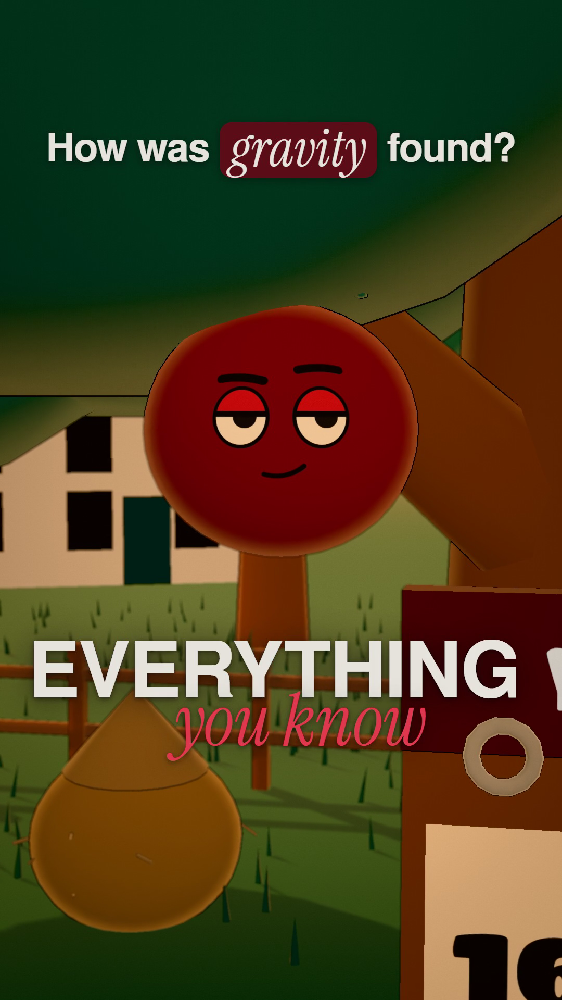

# 3D Cartoon Animation: a Claude skill

Make short vertical 3D cartoon explainers (30–60 s, 9:16) on any topic, with Claude. Big-headed toon characters live the story, their faces swap through a blink on the stressed word, every number lands as a real object, editorial captions pop in on the voice, and every action has its own sound.



The example film, **"How gravity was found"**, is in [`examples/how-gravity-was-found/final/`](examples/how-gravity-was-found/final/). It was made with this package and approved after three rounds of feedback.

## What's inside

| Folder | What it holds |
|---|---|
| [`SKILL.md`](SKILL.md) | **Start here.** The overview and the order of the steps. Claude reads this first. |
| `skills/` | The method as 14 steps: from finding the angle of a topic to the final frame check. |
| `recipe/engine/` | The animation engine (three.js): characters, painted faces, props, places, the look, captions. |
| `recipe/tools/` | The tools: render, voice, sound and music, the storyboard board, the quality checks. |
| `templates/` | A starter film for any topic, and the worksheets. |
| `examples/how-gravity-was-found/` | The approved film with its source, script, storyboard, voice, sound list and earlier versions. |
| `references/` | How the style works, the glitch catalogue, the engine reference, the feedback history. |
| `evaluation/` | The delivery checklist, what "done" means, and what the style can't do yet. |

## What you need

- **Claude with access to your files:** Claude Code, or the Claude desktop app with this folder attached.
- **Node.js 22 or newer.**
- **FFmpeg 6 or newer** (with ffprobe), on your PATH.
- **Python 3.10 or newer** with NumPy, for the music and sound effects.
- **A computer with a graphics card** that Chrome can use for WebGL2. Tested on Windows 11.
- **Optional:** an [ElevenLabs](https://elevenlabs.io) API key for the voice, or your own recorded voiceover.

## Set up

In this folder, run:

```
npm install
npx playwright install chromium
pip install -r requirements.txt
```

Check that it works by rendering the starter film's storyboard stills:

```
mkdir examples/test-film
cp -r templates/new-film/* examples/test-film/
node recipe/tools/render.mjs examples/test-film/film.mjs out/test --stills shots --qa
```

You should get four stills and a `contact-sheet.png` in `out/test/`. The "404" lines it prints are normal: they are the brand font files (see below) and the voice timings, which don't exist yet.

If FFmpeg isn't on your PATH, set `CARTOON_FFMPEG` to its full path. To use your own Chrome instead of Playwright's, set `CARTOON_CHROME`. All the settings are in [`recipe/tools/paths.mjs`](recipe/tools/paths.mjs).

## Use it with Claude

- **Claude Code:** copy this folder to `~/.claude/skills/3d-cartoon-animation/` so it is available in every project. Or open this folder in Claude Code.
- **Claude desktop app:** attach this folder to the chat.

Then ask, for example: *"Use the 3D Cartoon Animation skill to make a 30-second film on why the sky is blue."*

Claude follows the steps in [`SKILL.md`](SKILL.md):
1. It plans the film: the angle, the hook, the characters, the places and the numbers.
2. It writes a hook-first script with sources.
3. **It shows you a storyboard and waits for your approval.**
4. It records the voice.
5. It builds and renders every shot.
6. It designs the sound.
7. It checks every frame.

You review the film and ask for changes, round by round.

In these files, **"the owner" means you:** the person the films are made for, who approves the storyboard and the film.

## Make it yours

- **Colours:** the five brand colours are in `BRAND` in [`recipe/engine/core.mjs`](recipe/engine/core.mjs). Skill 5 explains where each one is used.
- **Fonts:** the captions are designed for Helvetica Bold and Editorial New Italic. They are not included, because both need a licence. Free stand-ins are used until you add your own licensed files to `recipe/engine/fonts/brand/` (see the README there). Every render prints which fonts it used.
- **Voice:** set your ElevenLabs key only for the one command (`ELEVENLABS_API_KEY=… node recipe/tools/voiceover.mjs examples/<slug>`). Never write it into a file. Any ElevenLabs voice works.

## Credits and licences

- **three.js** r186 (MIT): `recipe/engine/vendor/three/LICENSE`.
- **Fonts included:**
  - Titan One and Instrument Serif: SIL Open Font License, with their licence files.
  - TeX Gyre Heros: GUST Font License, with its licence file.
- **Music and sound effects** are all synthesised in code, with no samples. The effect design follows the documented techniques of [earshot](https://github.com/Leonxlnx/earshot) (MIT); none of its code is included.
- **The style was learned from** the tutorial "Opus 5.5 + Creatorize = MEGA Viral 3D Cartoon Animations! (Step-by-Step Guide)" by g russ ([YouTube](https://youtu.be/z9XflLHoMdg)). [`references/reference-study.md`](references/reference-study.md) is our own summary of what it teaches. None of the creator's footage, transcript or frames are included, and every character, set and joke here is original.
- **The example's voice** was made with ElevenLabs.
