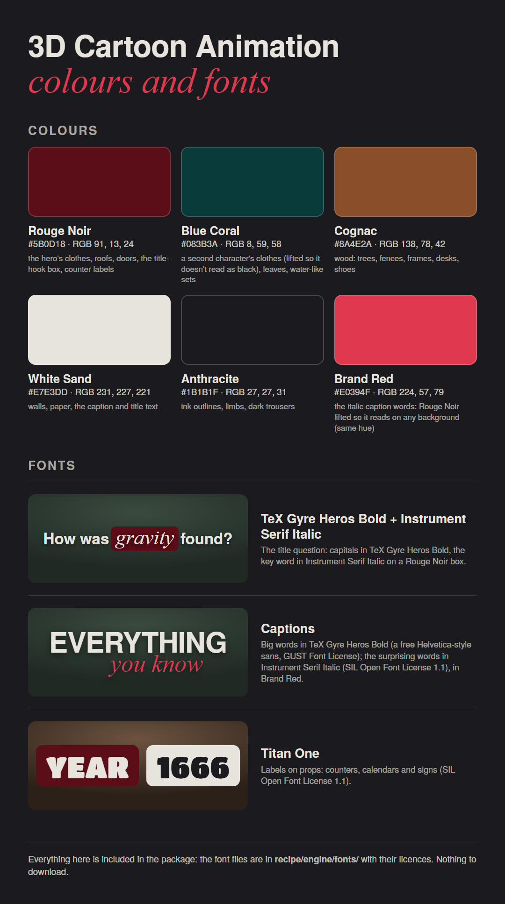

# Colours and fonts

These are the colours and fonts of the approved film, "How gravity was found". **They are all included:** the engine uses them automatically, and you don't need to download or install anything to make a film.

## Colours

| Colour | Hex | RGB | Where it's used |
|---|---|---|---|
| Rouge Noir | `#5B0D18` | 91, 13, 24 | the hero's clothes, roofs, doors, the title-hook box, counter labels |
| Blue Coral | `#083B3A` | 8, 59, 58 | a second character's clothes (lifted so it doesn't read as black), leaves, water-like sets |
| Cognac | `#8A4E2A` | 138, 78, 42 | wood: trees, fences, frames, desks, shoes |
| White Sand | `#E7E3DD` | 231, 227, 221 | walls, paper, the caption and title text |
| Anthracite | `#1B1B1F` | 27, 27, 31 | ink outlines, limbs, dark trousers |
| Brand Red | `#E0394F` | 224, 57, 79 | the italic caption words: Rouge Noir lifted so it reads on any background |

Large surfaces such as grass and leaves use lifted tints of these colours (`ENV` in `recipe/engine/core.mjs`). Real things keep their real colours: the Earth is blue and green.

## Fonts

| Font | Used for | File | Licence |
|---|---|---|---|
| TeX Gyre Heros Bold | caption and title capitals: a free Helvetica-style sans | `recipe/engine/fonts/standin/texgyreheros-bold.otf` | GUST Font License |
| Instrument Serif Italic | the italic words in captions and the title | `recipe/engine/fonts/standin/InstrumentSerif-Italic.ttf` | SIL Open Font License 1.1 |
| Titan One | labels on props: counters, calendars, signs | `recipe/engine/fonts/TitanOne-Regular.ttf` | SIL Open Font License 1.1 |

The regular weights of TeX Gyre Heros and Instrument Serif are in the same folder. All the licences allow you to use the fonts in your videos, including commercially, and to share them. Each licence file sits next to its font.

**To use them in other apps** (Canva, Photoshop, slides, thumbnails): install the font files from `recipe/engine/fonts/` on your computer. On Windows and macOS, double-click a file and choose Install.

**Optional upgrade:** the captions were designed around Helvetica Bold and Editorial New Italic. They are paid fonts, so they can't be shared here. If you own licences for them, put the files in `recipe/engine/fonts/brand/` (the README there gives the file names), and the engine uses them instead. Every render prints which fonts it used.

## Files in this folder

| File | What |
|---|---|
| `palette.json` | the colours and fonts in one file, for tools and other projects |
| `palette.css` | the colours as CSS variables and the fonts as `@font-face` rules, for web pages |
| `style-sheet.png` | the picture above |

## Make it your own

To change a colour:
1. Change it in `BRAND` (or `HIGHLIGHT`) in `recipe/engine/core.mjs`.
2. Change it in `palette.json` and `palette.css`.
3. Redraw the sheet with `node recipe/tools/style-sheet.mjs`. It checks that `palette.json` matches the engine before drawing.
